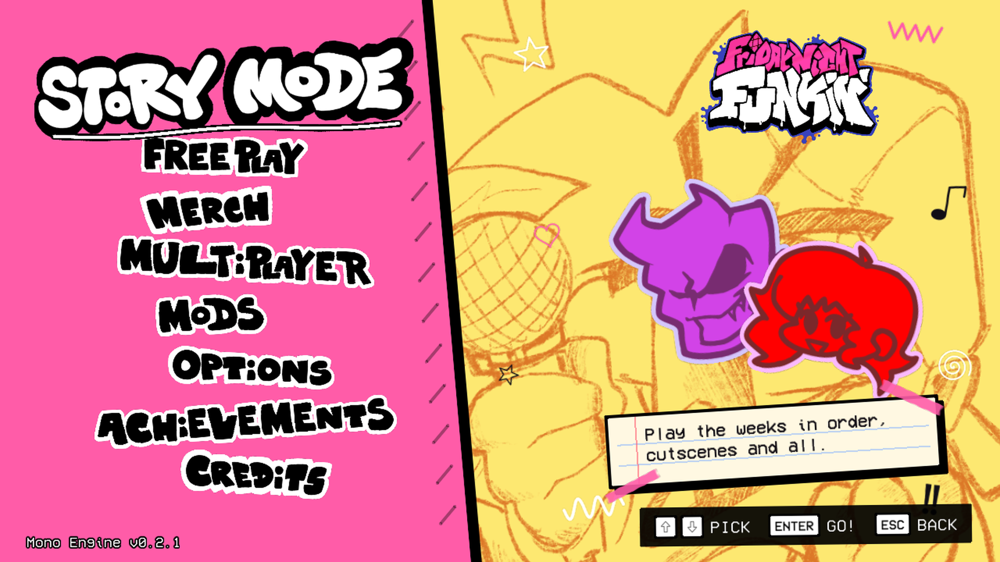
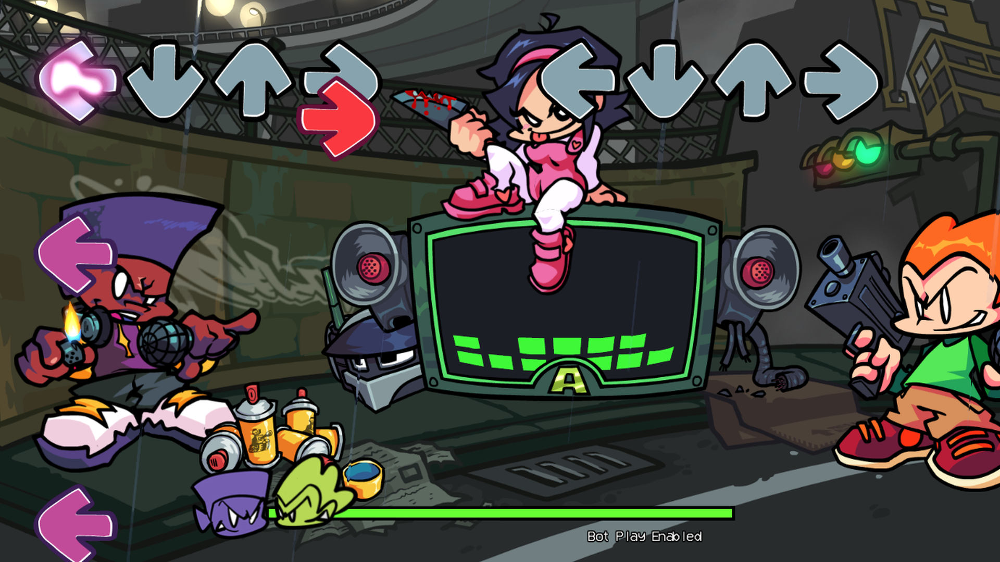
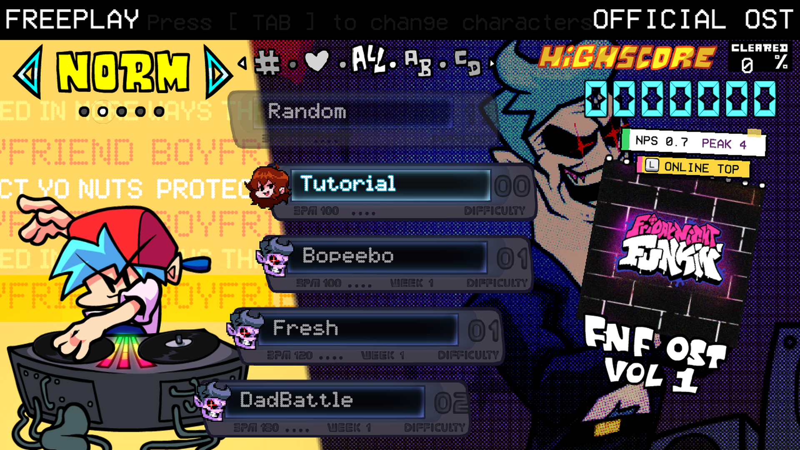
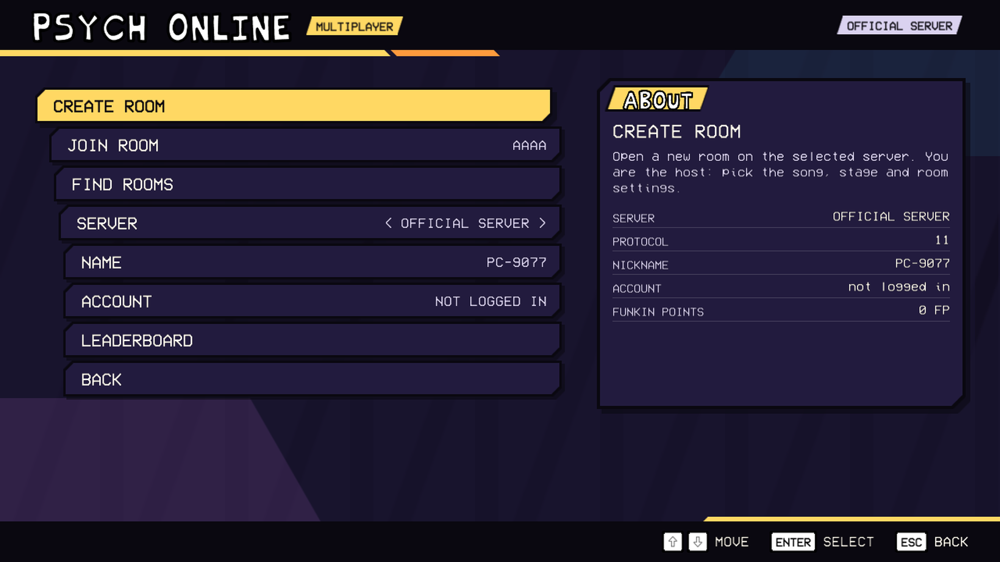
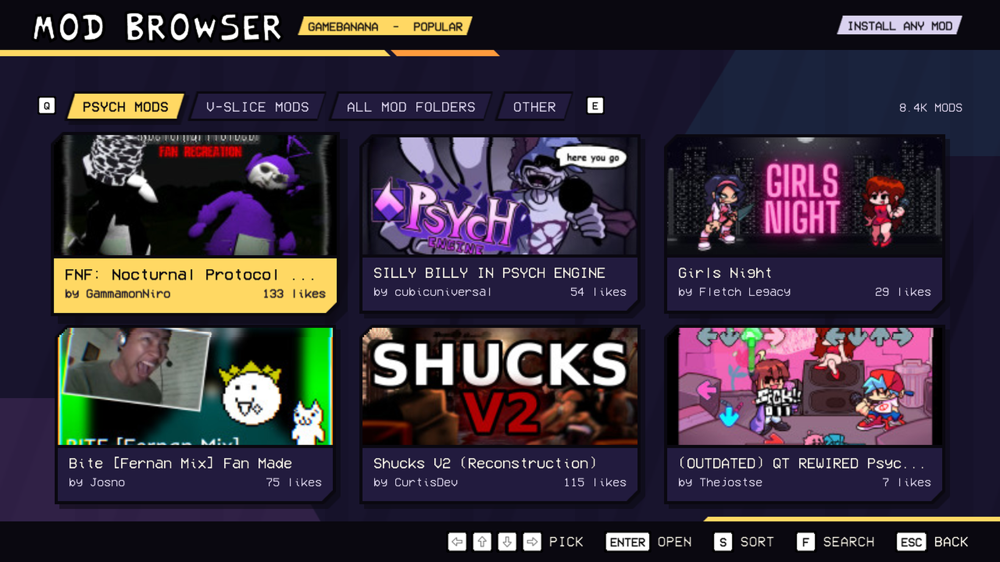
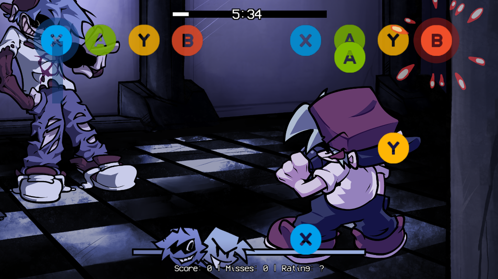
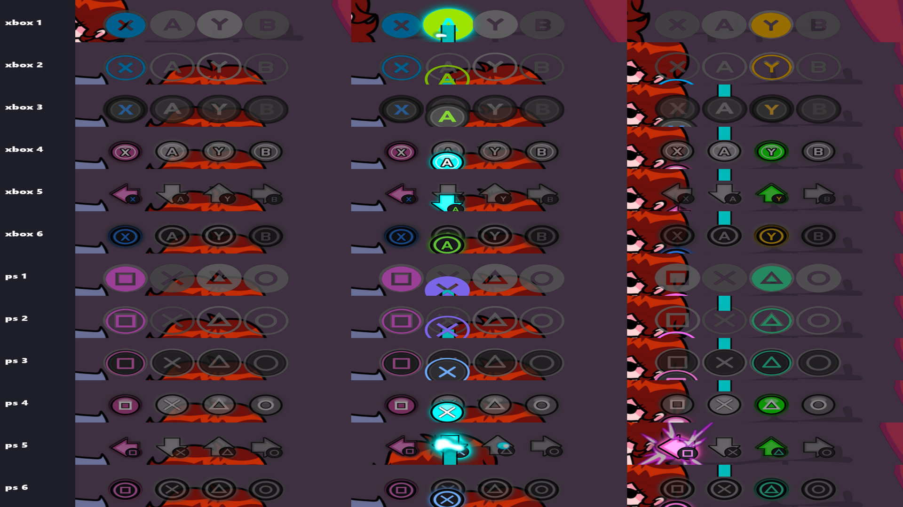

<div align="center">

# FNF Mono Engine

**A from-scratch C# / MonoGame port of the official Friday Night Funkin' (v0.8.1).**
Built to match the original game, running natively on Windows, Linux and Xbox —
with built-in support for Psych Engine and V-Slice mods as an extra.


[](https://apps.microsoft.com/store/detail/9PG8FW12RRQX)
[](https://discord.gg/JBMPPHTVjK)
[](https://buymeacoffee.com/dgamermohammad)



</div>

> **Not based on Psych Engine.** The engine is a new C# port of the official Friday Night Funkin' source code
> (the V-Slice version by The Funkin' Crew), running on MonoGame instead of HaxeFlixel. Psych Engine mods are
> supported through a compatibility layer, the same way the game supports V-Slice mods.
>
> **FNF Mono Engine is a fan-made port.** I am not the original developer of Friday Night Funkin'.
> Friday Night Funkin' is made by **The Funkin' Crew** — the original game is at
> [github.com/FunkinCrew/Funkin](https://github.com/FunkinCrew/Funkin). This project is free and not affiliated with
> The Funkin' Crew, Newgrounds, Microsoft or Sony.

---

## Screenshots

| Gameplay | Freeplay |
|---|---|
|  |  |
| **Psych Online** | **Mod browser** |
|  |  |
| **Psych mod (Silly Billy) on Xbox** | **Xbox controller notes** |
|  |  |

## Features
- **The full official game** — Weeks 1–7, Weekend 1, Freeplay, Erect / Nightmare and Pico mixes, character select, results and cutscenes, matched to the original v0.8.1.
- **Mod support** — Psych Engine mods (Lua + HScript) and V-Slice (Polymod) mods, plus an in-game GameBanana mod browser.
- **Multiplayer** — Psych Online, local 2-player and LAN versus.
- **Controllers first** — full controller support, rebinding, and controller button notes in 6 styles with Xbox and PlayStation icons.
- **Skins** — character skins and note skins.

## Supported platforms

| Platform | Status | Download | Notes |
|---|---|---|---|
|  **Windows 10 / 11 (64-bit)** | ✅ Supported | `FNF_MonoEngine-Alpha2.3-windows-x64.zip` | DirectX 11. Unzip and run `FNF_MonoGame.exe`. |
|  **Linux (64-bit)** | ✅ Supported | `FNF_MonoEngine-Alpha2.3-linux-x64.tar.gz` | OpenGL. Ubuntu, Debian, Mint, Pop!_OS, Fedora, Arch, Manjaro, openSUSE, SteamOS (Steam Deck) and other glibc distros. |
|  **Xbox Series X\|S / Xbox One** | ✅ Supported (Developer Mode) | `FNF_MonoEngine-Alpha2.3-xbox.msix` | Installed through Xbox Device Portal. |
|  **Microsoft Store (Xbox + PC)** | ⏳ Coming soon | [Store page](https://apps.microsoft.com/store/detail/9PG8FW12RRQX) | Free. Game data downloads from The Funkin' Crew's GitHub on first start. |
|  **macOS (Intel + Apple Silicon)** | 🟡 In progress | — | Builds, not tested on real Macs yet. |
|  **Android** | 🟡 In progress | — | Builds, touch controls not finished. |

## Install

### Windows
1. Download the Windows zip from [Releases](../../releases).
2. Unzip it anywhere and run **`FNF_MonoGame.exe`**.

### Linux
```bash
tar -xzf FNF_MonoEngine-Alpha2.3-linux-x64.tar.gz
cd FNF_MonoEngine
./FNF_DesktopGL
```
Optional: install `ffmpeg` for the cutscene videos (`sudo apt install ffmpeg`, `sudo dnf install ffmpeg`, `sudo pacman -S ffmpeg`).

### Microsoft Store
In progress — [FNF Mono Engine on the Microsoft Store](https://apps.microsoft.com/store/detail/9PG8FW12RRQX).

### Xbox (Developer Mode)
1. Put your Xbox in [Developer Mode](https://learn.microsoft.com/windows/uwp/xbox-apps/devkit-activation).
2. Open **Xbox Device Portal** in your browser → **Add** → choose `FNF_MonoEngine-Alpha2.3-xbox.msix`.
3. Start the game from **Dev Home**.

## Adding mods
- **Easiest:** open **Mods** in the main menu and download mods from GameBanana inside the game.
- **By hand:** put the mod folder into `mods/` next to the game (Xbox: `LocalState\mods` through Device Portal).
- Psych Engine mods and V-Slice (Polymod) mods both work.

## Controls

| Action | Keyboard | Controller |
|---|---|---|
| Notes | ← ↓ ↑ → / D F J K | D-pad / X A Y B |
| Confirm | Enter | A |
| Back | Esc | B |
| Pause | Enter / Esc | Menu |

Everything can be rebound in **Options → Controls**.

## Building from source

Requirements: [.NET 8 SDK](https://dotnet.microsoft.com/download), and Visual Studio 2022 with the UWP workload for the Xbox build.

```bash
git clone https://github.com/dgamermohammad09/friday-night-at-funkin-mono-engine.git
cd friday-night-at-funkin-mono-engine

# Windows (DirectX)
dotnet build FNF_MonoGame_Full/FNF_MonoGame.csproj -c Release

# Linux / macOS (OpenGL)
dotnet publish Platforms/DesktopGL/FNF_DesktopGL.csproj -c Release -r linux-x64 --self-contained
```
The game data (`Content` folder) is not in this repository — copy it from a release package into
`FNF_MonoGame_Full/Content`.

## Community
- 💬 **Discord:** [discord.gg/JBMPPHTVjK](https://discord.gg/JBMPPHTVjK) — bug reports, help and news
- ☕ **Support the project:** [buymeacoffee.com/dgamermohammad](https://buymeacoffee.com/dgamermohammad)
- 🐞 **Bugs:** open an [issue](../../issues) with your `game_log.txt`

## Credits

**FNF Mono Engine** — ported and developed by **Mohammad Aljafari**.

**Friday Night Funkin'** by **The Funkin' Crew** — ninjamuffin99, PhantomArcade, evilsk8r, Kawai Sprite and
everyone in the [original credits](https://github.com/FunkinCrew/Funkin).

## Projects used

| Project | Used for |
|---|---|
| [Friday Night Funkin'](https://github.com/FunkinCrew/Funkin) (The Funkin' Crew) | The original game source (v0.8.1) the engine is ported from |
| [funkin.assets](https://github.com/FunkinCrew/funkin.assets) (The Funkin' Crew) | Official game data, charts and scripts |
| [MonoGame](https://github.com/MonoGame/MonoGame) | Game framework: graphics, audio, input on every platform |
| [flixel-animate](https://github.com/MaybeMaru/flixel-animate) | Reference for Adobe Animate texture-atlas playback |
| [Psych Engine](https://github.com/ShadowMario/FNF-PsychEngine) (Shadow Mario) | Reference for Psych mod compatibility |
| [Psych Online](https://github.com/Snirozu/Funkin-Psych-Online) (Snirozu) | Online multiplayer protocol and features |
| [hscript-iris](https://github.com/pisayesiwsi/hscript-iris) | HScript interpreter for mods (compiled from Haxe to C#) |
| [MoonSharp](https://github.com/moonsharp-devs/moonsharp) | Lua scripting for mods |
| [FontStashSharp](https://github.com/FontStashSharp/FontStashSharp) | Text rendering |
| [NVorbis](https://github.com/NVorbis/NVorbis) / [NAudio](https://github.com/naudio/NAudio) | OGG music and sound decoding |
| [Newtonsoft.Json](https://github.com/JamesNK/Newtonsoft.Json) | Charts, characters and save files |
| [SharpCompress](https://github.com/adamhathcock/sharpcompress) | Unpacking downloaded mods (zip / rar / 7z) |
| [discord-rpc-csharp](https://github.com/Lachee/discord-rpc-csharp) | Discord Rich Presence |
| [GameBanana API](https://gamebanana.com) | In-game mod browser |
| [Kenney Input Prompts](https://kenney.nl/assets/input-prompts) · [Xelu's Controller Prompts](https://thoseawesomeguys.com/prompts/) · [Simple Icons](https://simpleicons.org) | Controller and logo icons (CC0) |
| [Quantico](https://fonts.google.com/specimen/Quantico) · [Inconsolata](https://fonts.google.com/specimen/Inconsolata) | UI fonts (SIL Open Font License) |

## License
The engine source code in this repository is free to read, learn from and build.
Friday Night Funkin' art, music and characters belong to **The Funkin' Crew Inc.** and follow
[their license](https://github.com/FunkinCrew/funkin.assets/blob/main/LICENSE.md). Mods belong to their own creators.
